# 17 — Entity Relationship Diagram (ERD)

## 17.1 Introduction

The Entity Relationship Diagram (ERD) represents the main data entities of the Board’s Cafe management system and the relationships between them.

The ERD is based on the database design described in Document 16 and reflects the main business processes of the system, including:

* User and role management
* Menu and recipe management
* Ingredient and inventory management
* Batch and expiry tracking
* FEFO stock usage
* Made-to-order preparation
* Customer order management
* Purchases and suppliers
* Expenses
* Waste management
* Notifications
* Audit logging

The database is designed so that stocked ingredients such as milk, wheat flour, tomatoes, vegetables, and other materials can be shared across multiple recipes and menu products.

---

## 17.2 ERD Overview

The main relationship between ordering, preparation, recipes, and inventory can be represented as:

```text
Customer Order
      |
      v
   Order Item
      |
      v
 Menu Product
      |
      v
    Recipe
      |
      v
Recipe Ingredient
      |
      v
Inventory Item
      |
      v
 Stock Batch
      |
      v
FEFO Selection
      |
      v
Ingredient Consumption
      |
      v
Stock Movement
```

This structure supports the made-to-order workflow used by the cafe.

---

## 17.3 Complete ERD

The following Mermaid ERD represents the main entities and relationships in the system.

```mermaid
erDiagram

    USER {
        int id PK
        string username
        string email
        string password
        string first_name
        string last_name
        boolean is_active
        datetime created_at
        datetime updated_at
    }

    ROLE {
        int id PK
        string name
        string description
        boolean is_active
        datetime created_at
        datetime updated_at
    }

    PERMISSION {
        int id PK
        string name
        string code
        string description
    }

    USER_ROLE {
        int id PK
        int user_id FK
        int role_id FK
        datetime assigned_at
        int assigned_by FK
    }

    ROLE_PERMISSION {
        int id PK
        int role_id FK
        int permission_id FK
        datetime assigned_at
        int assigned_by FK
    }

    MENU_CATEGORY {
        int id PK
        string name
        string description
        boolean is_active
        datetime created_at
        datetime updated_at
    }

    MENU_PRODUCT {
        int id PK
        int category_id FK
        string name
        string description
        decimal selling_price
        boolean is_available
        boolean is_active
        datetime created_at
        datetime updated_at
    }

    RECIPE {
        int id PK
        int menu_product_id FK
        string name
        string instructions
        boolean is_active
        datetime created_at
        datetime updated_at
    }

    RECIPE_INGREDIENT {
        int id PK
        int recipe_id FK
        int inventory_item_id FK
        decimal quantity_required
        int unit_id FK
        datetime created_at
        datetime updated_at
    }

    INVENTORY_CATEGORY {
        int id PK
        string name
        string description
        boolean is_active
    }

    UNIT {
        int id PK
        string name
        string abbreviation
        string unit_type
        boolean is_active
    }

    INVENTORY_ITEM {
        int id PK
        int category_id FK
        int unit_id FK
        string name
        string description
        decimal reorder_level
        decimal reorder_quantity
        boolean is_active
        datetime created_at
        datetime updated_at
    }

    STOCK_BATCH {
        int id PK
        int inventory_item_id FK
        int purchase_item_id FK
        string batch_number
        decimal quantity_received
        decimal quantity_remaining
        decimal unit_cost
        date received_date
        date expiry_date
        string status
        datetime created_at
        datetime updated_at
    }

    STOCK_MOVEMENT {
        int id PK
        int inventory_item_id FK
        int stock_batch_id FK
        int user_id FK
        string movement_type
        decimal quantity
        decimal unit_cost
        string reference_type
        int reference_id
        string notes
        datetime created_at
    }

    INGREDIENT_CONSUMPTION {
        int id PK
        int order_item_id FK
        int recipe_ingredient_id FK
        int inventory_item_id FK
        int stock_batch_id FK
        decimal quantity_consumed
        decimal unit_cost
        datetime consumed_at
        int consumed_by FK
    }

    SUPPLIER {
        int id PK
        string name
        string contact_person
        string phone
        string email
        string address
        boolean is_active
        datetime created_at
        datetime updated_at
    }

    PURCHASE {
        int id PK
        int supplier_id FK
        int created_by FK
        string purchase_number
        date purchase_date
        decimal total_amount
        string status
        string notes
        datetime created_at
        datetime updated_at
    }

    PURCHASE_ITEM {
        int id PK
        int purchase_id FK
        int inventory_item_id FK
        decimal quantity
        decimal unit_cost
        decimal total_cost
        datetime created_at
    }

    ORDER {
        int id PK
        int created_by FK
        string order_number
        datetime order_date
        decimal subtotal
        decimal discount
        decimal total_amount
        string status
        string notes
        datetime created_at
        datetime updated_at
    }

    ORDER_ITEM {
        int id PK
        int order_id FK
        int menu_product_id FK
        int quantity
        decimal unit_price
        decimal subtotal
        string notes
        datetime created_at
    }

    PAYMENT {
        int id PK
        int order_id FK
        decimal amount
        string payment_method
        string status
        string transaction_reference
        datetime paid_at
        int received_by FK
    }

    EXPENSE_CATEGORY {
        int id PK
        string name
        string description
        boolean is_active
    }

    EXPENSE {
        int id PK
        int category_id FK
        int recorded_by FK
        string description
        decimal amount
        date expense_date
        string payment_method
        string reference
        datetime created_at
        datetime updated_at
    }

    WASTE {
        int id PK
        int recorded_by FK
        string waste_number
        date waste_date
        string reason
        decimal total_cost
        string notes
        datetime created_at
    }

    WASTE_ITEM {
        int id PK
        int waste_id FK
        int inventory_item_id FK
        int stock_batch_id FK
        decimal quantity
        decimal unit_cost
        decimal total_cost
        string reason
    }

    NOTIFICATION {
        int id PK
        int user_id FK
        string title
        string message
        string notification_type
        boolean is_read
        string reference_type
        int reference_id
        datetime created_at
    }

    AUDIT_LOG {
        int id PK
        int user_id FK
        string action
        string resource_type
        int resource_id
        string description
        string ip_address
        datetime created_at
    }


    USER ||--o{ USER_ROLE : has
    ROLE ||--o{ USER_ROLE : assigned_to

    ROLE ||--o{ ROLE_PERMISSION : has
    PERMISSION ||--o{ ROLE_PERMISSION : assigned_to

    USER ||--o{ USER_ROLE : assigns
    USER ||--o{ ROLE_PERMISSION : assigns

    MENU_CATEGORY ||--o{ MENU_PRODUCT : contains
    MENU_PRODUCT ||--o{ RECIPE : has
    RECIPE ||--o{ RECIPE_INGREDIENT : contains

    INVENTORY_CATEGORY ||--o{ INVENTORY_ITEM : contains
    UNIT ||--o{ INVENTORY_ITEM : measures
    UNIT ||--o{ RECIPE_INGREDIENT : uses

    INVENTORY_ITEM ||--o{ RECIPE_INGREDIENT : used_in
    INVENTORY_ITEM ||--o{ STOCK_BATCH : has

    PURCHASE ||--o{ PURCHASE_ITEM : contains
    SUPPLIER ||--o{ PURCHASE : supplies
    INVENTORY_ITEM ||--o{ PURCHASE_ITEM : purchased_as
    PURCHASE_ITEM ||--o{ STOCK_BATCH : creates

    INVENTORY_ITEM ||--o{ STOCK_MOVEMENT : has
    STOCK_BATCH ||--o{ STOCK_MOVEMENT : records
    USER ||--o{ STOCK_MOVEMENT : performs

    ORDER ||--o{ ORDER_ITEM : contains
    MENU_PRODUCT ||--o{ ORDER_ITEM : ordered_as
    USER ||--o{ ORDER : creates

    ORDER ||--o{ PAYMENT : receives
    USER ||--o{ PAYMENT : receives

    ORDER_ITEM ||--o{ INGREDIENT_CONSUMPTION : causes
    RECIPE_INGREDIENT ||--o{ INGREDIENT_CONSUMPTION : consumed_as
    INVENTORY_ITEM ||--o{ INGREDIENT_CONSUMPTION : consumed
    STOCK_BATCH ||--o{ INGREDIENT_CONSUMPTION : taken_from
    USER ||--o{ INGREDIENT_CONSUMPTION : records

    EXPENSE_CATEGORY ||--o{ EXPENSE : categorizes
    USER ||--o{ EXPENSE : records

    WASTE ||--o{ WASTE_ITEM : contains
    INVENTORY_ITEM ||--o{ WASTE_ITEM : wasted
    STOCK_BATCH ||--o{ WASTE_ITEM : taken_from
    USER ||--o{ WASTE : records

    USER ||--o{ NOTIFICATION : receives
    USER ||--o{ AUDIT_LOG : performs
```



---

## 17.4 Administration Relationships

The administration section manages users, roles, and permissions.

```text
USER
  |
  | 1:M
  v
USER_ROLE
  |
  | M:1
  v
ROLE
  |
  | 1:M
  v
ROLE_PERMISSION
  |
  | M:1
  v
PERMISSION
```

This allows the system to support:

* Creating staff accounts
* Assigning roles to users
* Defining permissions for roles
* Changing user roles
* Activating or deactivating users
* Controlling access to system functions

A user may have one or more roles if the final implementation requires multiple role assignments.

---

## 17.5 Menu and Recipe Relationships

The menu structure is represented as:

```text
MENU_CATEGORY
      |
      | 1:M
      v
MENU_PRODUCT
      |
      | 1:M
      v
RECIPE
      |
      | 1:M
      v
RECIPE_INGREDIENT
      |
      | M:1
      v
INVENTORY_ITEM
```

For example:

```text
Menu Category
   └── Bakery
        └── Cake
             └── Cake Recipe
                  ├── Wheat Flour
                  ├── Milk
                  ├── Sugar
                  └── Eggs
```

The recipe does not create a separate copy of the inventory item. It references the existing inventory item.

---

## 17.6 Shared Ingredients

An important relationship in the system is the many-to-many relationship between menu products and inventory items.

This is implemented through `RecipeIngredient`.

```text
MENU_PRODUCT
     |
     v
   RECIPE
     |
     v
RECIPE_INGREDIENT
     |
     v
INVENTORY_ITEM
```

The same inventory item can therefore be used by many recipes.

For example:

```text
                 ┌── Cake Recipe
                 │
Milk ────────────┼── Tea Recipe
                 │
                 ├── Coffee Recipe
                 │
                 └── Pancake Recipe
```

Similarly, wheat flour can be shared across multiple menu products, while tomatoes and other vegetables can be used by different food recipes.

This avoids duplicate inventory records and makes stock management more accurate.

---

## 17.7 Inventory and Batch Relationships

Inventory items represent the materials stocked by the cafe.

A single inventory item can have multiple stock batches.

```text
INVENTORY_ITEM
      |
      | 1:M
      v
 STOCK_BATCH
```

For example:

```text
Inventory Item: Milk

Batch A
Received: 01 Oct
Expiry:   05 Oct
Remaining: 8 L

Batch B
Received: 03 Oct
Expiry:   08 Oct
Remaining: 15 L
```

The system must keep the batches separate because they can have different:

* Batch numbers
* Expiry dates
* Received dates
* Unit costs
* Quantities
* Statuses

---

## 17.8 Purchase and Batch Relationships

The purchase structure is:

```text
SUPPLIER
    |
    | 1:M
    v
PURCHASE
    |
    | 1:M
    v
PURCHASE_ITEM
    |
    | 1:M
    v
STOCK_BATCH
    |
    v
INVENTORY_ITEM
```

A purchase may contain several items.

A purchase item may create one or more stock batches where necessary.

For example:

```text
Purchase #PO-001

Milk       → Batch M001
Milk       → Batch M002
Flour      → Batch F001
Tomatoes   → Batch T001
```

This structure supports proper batch-level expiry and cost tracking.

---

## 17.9 Order Relationships

Customer orders are represented by:

```text
ORDER
  |
  | 1:M
  v
ORDER_ITEM
  |
  | M:1
  v
MENU_PRODUCT
```

One order can contain multiple menu products.

Example:

```text
Order #ORD-001

2 × Coffee
1 × Cake
3 × Samosa
```

Each product is stored as a separate `OrderItem`.

The selling price is stored on the order item so that historical orders are not affected when the current menu price changes.

---

## 17.10 Made-to-Order Consumption

The system supports preparing products when an order is placed.

The main relationship is:

```text
ORDER
  |
  v
ORDER_ITEM
  |
  v
RECIPE
  |
  v
RECIPE_INGREDIENT
  |
  v
STOCK_BATCH
  |
  v
INGREDIENT_CONSUMPTION
```

When an order is fulfilled, the system identifies the ingredients required by the recipe.

It then selects suitable stock batches, preferably using FEFO where expiry tracking applies.

The actual quantity consumed is recorded in `IngredientConsumption`.

This provides a traceable connection between:

* The customer order
* The menu product
* The recipe
* The ingredient
* The exact stock batch used
* The quantity consumed
* The staff member who recorded the consumption

---

## 17.11 FEFO Relationship

FEFO means **First Expired, First Out**.

The ERD supports FEFO through the relationship:

```text
INVENTORY_ITEM
      |
      v
 STOCK_BATCH
      |
      ├── expiry_date
      ├── quantity_remaining
      └── status
```

When an ingredient is required, eligible batches can be ordered by expiry date.

Example:

```text
Milk

Batch M001 → expires 05 Oct → use first
Batch M002 → expires 08 Oct
Batch M003 → expires 12 Oct
```

The selected batch is then referenced by `IngredientConsumption`.

---

## 17.12 Stock Movement Relationships

Stock movements provide a history of inventory changes.

```text
INVENTORY_ITEM
      |
      v
STOCK_MOVEMENT
      |
      v
STOCK_BATCH
```

A stock movement may represent:

* Stock received
* Ingredient consumption
* Waste
* Stock adjustment
* Stock return
* Other approved inventory changes

The movement records the quantity and the event responsible for the change.

---

## 17.13 Waste Relationships

Waste is recorded separately from normal stock consumption.

```text
WASTE
  |
  | 1:M
  v
WASTE_ITEM
  |
  ├── INVENTORY_ITEM
  |
  └── STOCK_BATCH
```

This allows the system to determine:

* What was wasted
* How much was wasted
* Which batch was affected
* Why it was wasted
* The cost of the wasted stock
* Which staff member recorded the waste

Expired products can therefore be recorded as waste while maintaining batch traceability.

---

## 17.14 Payment Relationships

Payments are connected to orders.

```text
ORDER
  |
  | 1:M
  v
PAYMENT
```

This allows the system to support payment records associated with an order.

Payment information may include:

* Amount
* Payment method
* Payment status
* Transaction reference
* Payment date/time
* Staff member who received or recorded the payment

Sensitive payment credentials should not be stored in the database.

---

## 17.15 Expense Relationships

Expenses are grouped into expense categories.

```text
EXPENSE_CATEGORY
       |
       | 1:M
       v
    EXPENSE
       |
       v
      USER
```

Examples of expense categories may include:

* Utilities
* Transport
* Maintenance
* Supplies
* Other operational expenses

The exact categories can be managed by authorized staff.

---

## 17.16 Notification Relationships

Notifications belong to individual users.

```text
USER
  |
  | 1:M
  v
NOTIFICATION
```

Notifications can be used for events such as:

* Products approaching expiry
* Products already expired
* Low-stock alerts
* Purchase updates
* Important system activities
* Other configured alerts

The notification can optionally reference the related system resource using `reference_type` and `reference_id`.

---

## 17.17 Audit Log Relationships

Audit logs record important actions performed by users.

```text
USER
  |
  | 1:M
  v
AUDIT_LOG
```

The audit log can record:

* User who performed the action
* Action performed
* Resource affected
* Resource ID
* Description
* Date and time
* IP address where applicable

Examples:

```text
Admin created a new user
Staff received a stock purchase
Staff recorded inventory waste
Manager changed a product price
Staff completed an order
Admin changed a user's role
```

Passwords, authentication tokens, and other sensitive secrets must not be stored in audit logs.

---

## 17.18 Core Many-to-Many Relationships

Several important many-to-many relationships are implemented through intermediary entities.

### User ↔ Role

```text
USER
  |
USER_ROLE
  |
ROLE
```

### Role ↔ Permission

```text
ROLE
  |
ROLE_PERMISSION
  |
PERMISSION
```

### Menu Product ↔ Inventory Item

```text
MENU_PRODUCT
      |
    RECIPE
      |
RECIPE_INGREDIENT
      |
INVENTORY_ITEM
```

### Order ↔ Menu Product

```text
ORDER
  |
ORDER_ITEM
  |
MENU_PRODUCT
```

These intermediary entities allow additional information to be stored about each relationship.

---

## 17.19 Stock Traceability

The database should make it possible to trace stock from its source to its final use.

A typical traceability path is:

```text
SUPPLIER
   ↓
PURCHASE
   ↓
PURCHASE_ITEM
   ↓
STOCK_BATCH
   ↓
INVENTORY_ITEM
   ↓
RECIPE
   ↓
ORDER_ITEM
   ↓
INGREDIENT_CONSUMPTION
   ↓
STOCK_MOVEMENT
```

For wasted stock:

```text
SUPPLIER
   ↓
PURCHASE
   ↓
STOCK_BATCH
   ↓
WASTE_ITEM
   ↓
WASTE
```

This is important for expiry management, inventory control, cost analysis, and auditing.

---

## 17.20 Example: Milk Lifecycle

The database should support the following example:

```text
Supplier
   ↓
Purchase Milk
   ↓
Purchase Item
   ↓
Milk Batch
   ├── Batch Number
   ├── Quantity
   ├── Unit Cost
   └── Expiry Date
        ↓
Inventory
        ↓
Recipe Ingredient
        ↓
Customer Order
        ↓
Ingredient Consumption
        ↓
Stock Movement
```

If the milk expires before being used:

```text
Milk Batch
    ↓
Expired
    ↓
Waste Item
    ↓
Waste Record
    ↓
Stock Movement
```

---

## 17.21 Data Integrity Rules

The database should enforce appropriate integrity rules.

Important rules include:

1. Every inventory item must belong to an inventory category.
2. Every stock batch must belong to an inventory item.
3. Every recipe ingredient must reference an existing recipe and inventory item.
4. Every order item must reference an existing order and menu product.
5. Every purchase item must reference an existing purchase and inventory item.
6. Quantities must not be negative unless specifically required for a controlled stock adjustment.
7. Stock consumption must not exceed available stock.
8. A batch marked as expired must not normally be selected for normal consumption.
9. Inactive products should not normally be available for new orders.
10. Inactive users should not be allowed to perform normal system operations.
11. Historical order prices should remain unchanged after menu price updates.
12. Important stock operations should be performed inside database transactions.
13. Audit records should not be freely editable by ordinary users.

---

## 17.22 Historical Data Preservation

Historical records should preserve the information that was valid when an event occurred.

For example, if a menu product changes from:

```text
Coffee = 1,000 RWF
```

to:

```text
Coffee = 1,500 RWF
```

previous orders must continue to show the original selling price.

Therefore, `OrderItem.unit_price` stores the price used at the time of the order.

The same principle applies to inventory costs where historical cost information is required.

---

## 17.23 Inactive Records

Records such as users, roles, products, inventory items, suppliers, and categories may be deactivated instead of immediately deleted.

This helps preserve historical information.

For example:

```text
MENU_PRODUCT
is_active = false
```

means the product is no longer available for normal operations while previous orders containing that product remain intact.

---

## 17.24 Database Transactions

Operations that affect multiple related records should be handled using database transactions.

For example, when an order consumes ingredients:

```text
1. Create/update order
2. Create order items
3. Identify recipe ingredients
4. Select eligible stock batches
5. Record ingredient consumption
6. Reduce batch quantities
7. Record stock movements
8. Complete the operation
```

If one critical operation fails, the related changes should be rolled back where appropriate.

This prevents situations where stock is reduced but the consumption record was not saved.

---

## 17.25 Database Normalization

The database should follow relational database normalization principles to reduce:

* Duplicate data
* Inconsistent records
* Update anomalies
* Unnecessary storage
* Difficult maintenance

For example, milk should be stored once as an `InventoryItem` and referenced by multiple recipes instead of creating separate milk records for every menu product.

---

## 17.26 Reporting Relationships

The database structure supports reports based on:

### Sales

```text
ORDER
  ↓
ORDER_ITEM
  ↓
MENU_PRODUCT
```

### Inventory

```text
INVENTORY_ITEM
  ↓
STOCK_BATCH
  ↓
STOCK_MOVEMENT
```

### Expiry

```text
INVENTORY_ITEM
  ↓
STOCK_BATCH
  ↓
expiry_date
```

### Waste

```text
WASTE
  ↓
WASTE_ITEM
  ↓
STOCK_BATCH
```

### Purchases

```text
SUPPLIER
  ↓
PURCHASE
  ↓
PURCHASE_ITEM
```

### Expenses

```text
EXPENSE_CATEGORY
  ↓
EXPENSE
```

These relationships provide the foundation for dashboard statistics and operational reports.

---

## 17.27 ERD Design Summary

The Board’s Cafe database is centered around five major operational areas:

```text
                 BOARD'S CAFE DATABASE
                         |
       ┌─────────────────┼─────────────────┐
       ↓                 ↓                 ↓
 Administration       Sales            Inventory
       |                 |                 |
 User/Role/           Order/Item        Item/Batch
 Permission           Payment           Movement
       |                 |                 |
       └─────────────────┼─────────────────┘
                         ↓
                    Menu & Recipes
                         |
                    RecipeIngredient
                         |
                    Stock Consumption
                         |
              ┌──────────┴──────────┐
              ↓                     ↓
           Purchases              Waste
              |                     |
           Supplier             Waste Item
```

The ERD provides the structural foundation for implementing the Board’s Cafe database.

The most important design principle is that **menu products and stocked ingredients are separate concepts**. Menu products represent what the cafe sells, while inventory items represent the ingredients and materials used to prepare those products.

Recipes connect the two, allowing shared ingredients such as milk, wheat flour, tomatoes, and vegetables to be used across multiple menu products.

Batch-level stock tracking then connects inventory to expiry dates, FEFO selection, consumption, waste, and stock movements, providing the traceability required for reliable cafe inventory management.

---